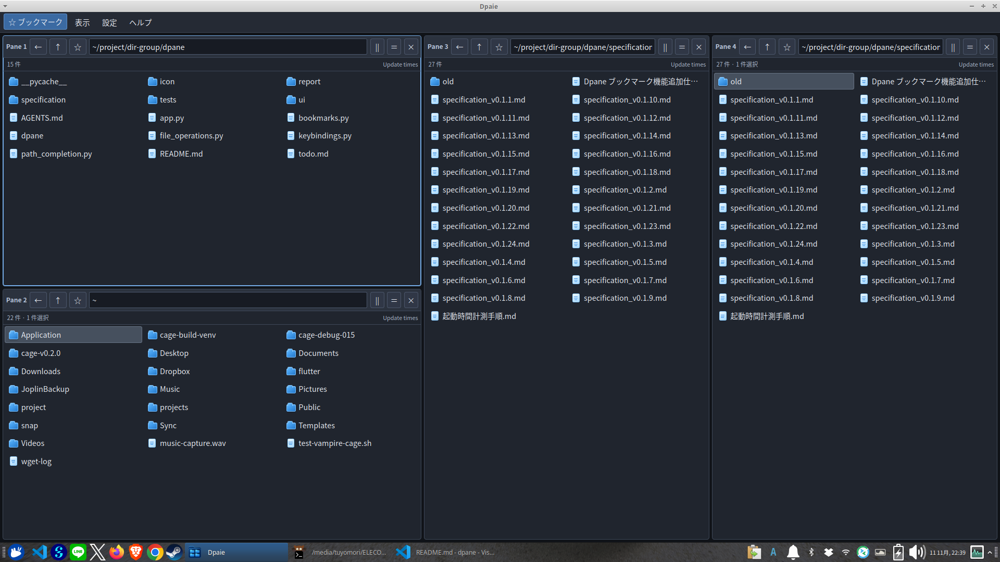

# Dpane

Dpaneは、複数のディレクトリを一つのウィンドウに並べて操作できる、Xubuntu 24.04 / Xfce向けのファイル管理アプリです。ペインごとに別のフォルダを開き、左右・上下に分割して使えます。

Fedoraでも、必要な依存関係を揃えた環境で起動を確認しています。Fedoraのバージョンや個別機能の確認結果は未記録です。

- 起動時は1〜4ペインを選び、起動後は最大8ペインまで追加・分割してサイズを調整
- ペイン間でファイルをコピー・移動し、フォルダごとに独立して移動
- ブックマーク、名前の前方一致検索、ショートカットに対応

## スクリーンショット



## インストール・起動

Git、Python 3、PyGObject、GTK 3、WebKitGTK 4.1が必要です。Xubuntu 24.04では、必要に応じて次のパッケージをインストールします。

```bash
sudo apt install git python3 python3-gi gir1.2-gtk-3.0 gir1.2-webkit2-4.1
```

リポジトリを取得して起動します。

```bash
git clone https://github.com/tuyomori-cyber/dpane.git
cd dpane
./dpane
```

初期状態ではホーム、`~/Downloads`、`~/Documents` を3ペインで開きます。「表示」→「起動時のペイン数」で次回起動時の数を1〜4に変更でき、起動後は最大8ペインまで追加できます。存在しないフォルダはエラーを表示するので、パス欄で別のフォルダを指定してください。

## 基本操作

### ペインとフォルダ

- ペインをクリックして操作対象にします。`||` / `＝` で右 / 下にペインを追加し、境界をドラッグしてサイズを変えられます。
- パス欄にフォルダを入力するか、一覧のフォルダをダブルクリックして移動します。`↑` は親フォルダ、`←` はそのペインの直前のフォルダへ戻ります。
- ペインの `×` でペインを閉じます。最後のペインを閉じるとアプリが終了します。

### ファイル操作

- クリックで選択し、ダブルクリックまたは `Enter` で開きます。`Ctrl` / `Shift` を使った複数選択もできます。
- `Ctrl+C` / `Ctrl+X` でコピー / 切り取りを準備し、移動先のペインで `Ctrl+V` を押します。ペイン間のドラッグはコピーです。
- `Delete` は確認後にゴミ箱へ移動し、`F2` は名前を変更します。右クリックから新しいファイルやフォルダも作成できます。
- 同名の通常ファイルへの貼り付けでは、連番・上書き・キャンセルを選べます。フォルダやシンボリックリンクを含む衝突では上書き・結合を行いません。

## 便利な機能

- **ブックマーク**：パス欄の `☆` で現在のフォルダを登録し、上部メニューから開けます。
- **検索とパス補完**：一覧で文字を入力するか `Ctrl+F` を押すと、表示中の名前を先頭から検索できます。パス欄では `Tab` でフォルダ候補を補完できます。
- **表示設定**：「表示」メニューから拡大率、隠し項目、ショートカット案内を変更できます。各ペインの「Update times」で更新日時を表示できます。

## キーボードショートカット

| キー | 操作 |
| --- | --- |
| `Ctrl+Shift+L` / `Ctrl+Shift+J` | 右 / 下にペインを追加 |
| `Ctrl+Shift+W` | ペインを閉じる |
| `Ctrl+Tab` / `Ctrl+Shift+Tab` | 次 / 前のペインへ移動 |
| `Alt+1`〜`Alt+8` | 表示順のペインへ移動 |
| `Ctrl+C` / `Ctrl+X` / `Ctrl+V` | コピー / 切り取り / 貼り付け |
| `Delete` / `F2` | ゴミ箱へ移動 / 名前変更 |
| `Ctrl+F` | 一覧の検索欄を開く |
| `Ctrl+T` | 更新日時を表示 / 非表示 |
| `Ctrl+K` | ショートカット一覧を開く / 閉じる |

アプリ内の「ヘルプ」→「ショートカット一覧」でも確認できます。全一覧と設定方法は[詳細操作ガイド](docs/操作ガイド.md)にあります。

## 設定

表示設定とブックマークは、通常 `~/.config/dpane/` に保存されます。ショートカットは設定ファイルで変更でき、「設定」メニューから初期化できます。保存先、設定方法と初期化については[詳細操作ガイド](docs/操作ガイド.md)を参照してください。

## 制限事項

- 一覧は各フォルダにつき最大1,000件です。
- コピー・切り取りの予約はアプリ内のみです。他アプリとのクリップボード連携、ドラッグ移動、レイアウトの保存・復元は未対応です。
- 異なるファイルシステム間では、切り取りによる同名ファイルの上書きはできません。
- 複数項目の操作は一括トランザクションではなく、一部だけ成功することがあります。上書きの最終確認後に他のプロセスが対象を更新した場合、その更新が失われる可能性があります。
- 外部アプリへのドラッグはコピーです。ドロップ先によって動作しない場合があります。

操作や制約の詳細は[詳細操作ガイド](docs/操作ガイド.md)を参照してください。

## 開発情報

- [現行仕様書 v0.2.1](specification/specification_v0.2.1.md)
- [TODO](todo.md)・[作業報告](report/webUI-report.md)
- [ファイル操作の安全性テスト](tests/file_operation_safety/実機テスト仕様書.md)
- [起動時間の計測手順](specification/起動時間計測手順.md)

旧称は `dir-group-webUI` です。起動スクリプトはシステムのPythonから `app.py` を呼び出します。`dpane` をPATHへインストールする設定は含まれていません。

## ライセンス

[MIT License](LICENSE)（Copyright © 2026 tuyomori-cyber）
